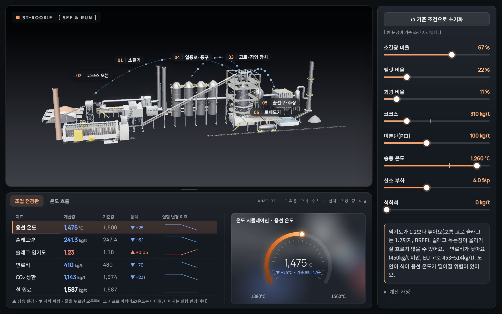
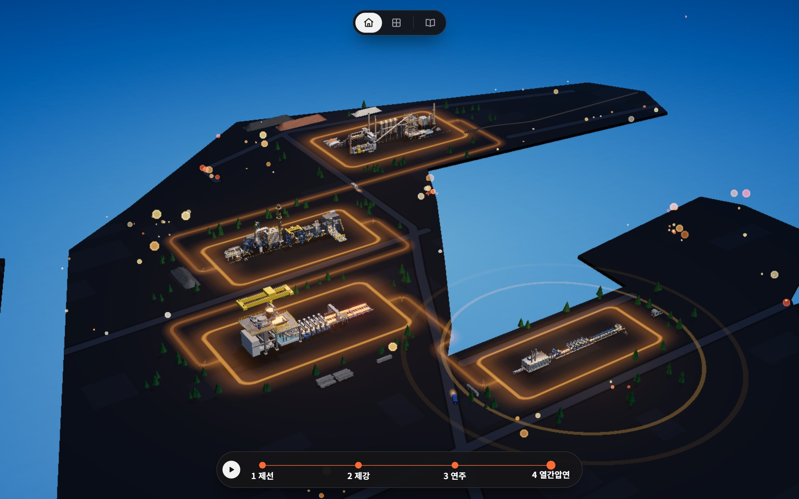
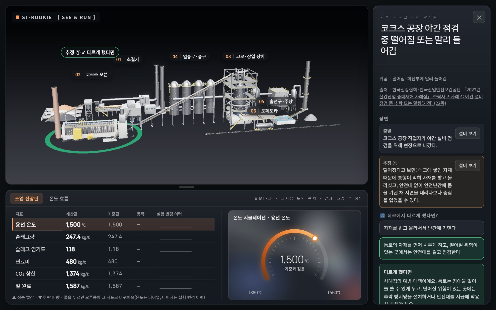
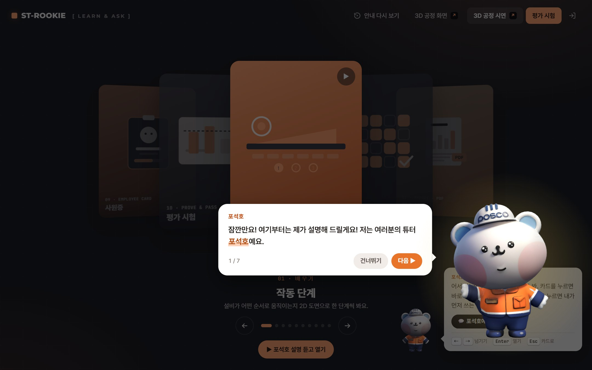
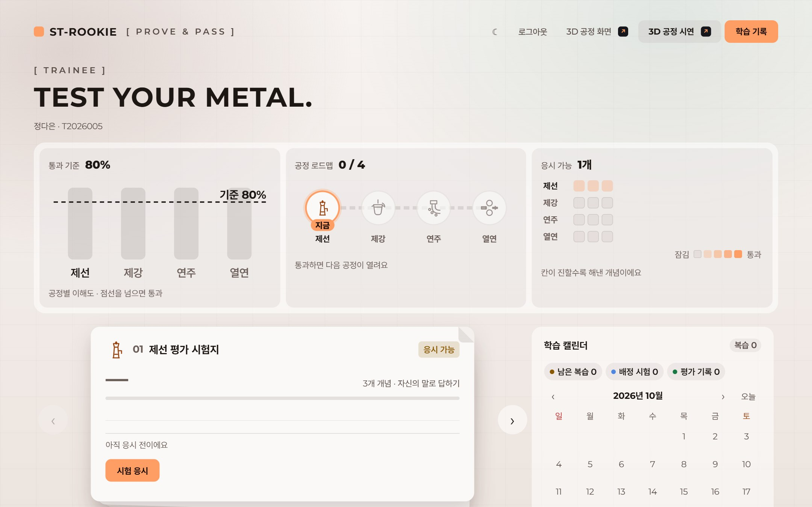
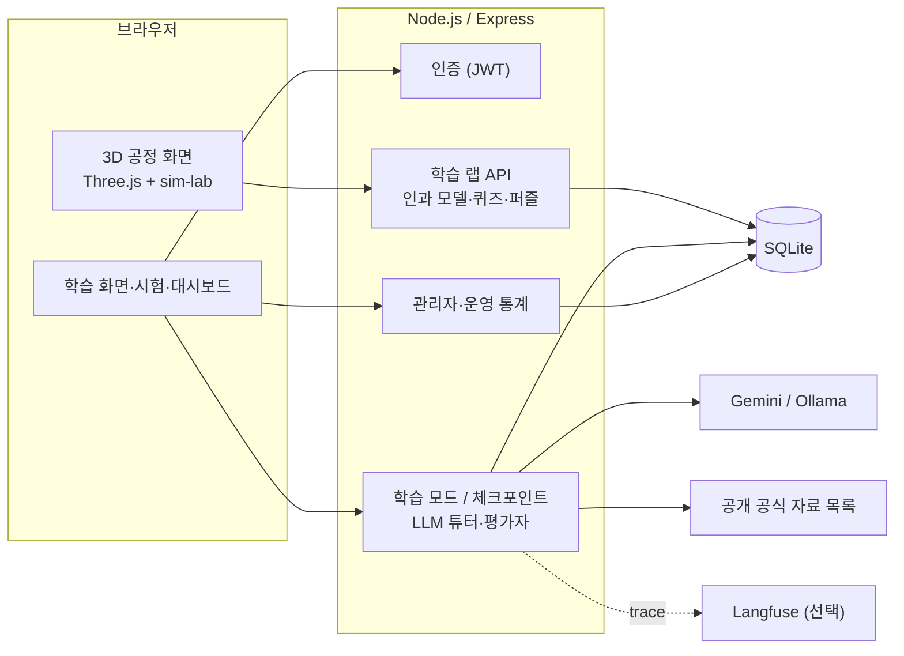

# ST-ROOKIE: 제철소 신입사원용 3D 공정 교육 플랫폼

> 제철 4대 공정(제선·제강·연주·열간압연)을 3D 공장 위에서 직접 조작하며 배우고, LLM 튜터에게 묻고, 자신의 말로 설명하는 시험까지 한 흐름으로 잇는 **신입사원 온보딩 DX 프로토타입**입니다.



| 항목 | 내용 |
|---|---|
| 형태 | 5인 팀 프로젝트 (2026.09.30 ~ 2026.10.21) |
| 원본 레포 | [steel-rookie/ST-ROOKIE](https://github.com/steel-rookie/ST-ROOKIE) (비공개 조직 레포) |
| 이 레포 | 면접 포트폴리오용 공개 사본. 민감 정보와 팀 내부 문서를 빼고 커밋 기록 없이 새로 올렸습니다 |
| 내 역할 | **3D 인과 실습(학습 랩)·학습 화면·튜터 캐릭터·운영 통계** 담당 ([아래](#내가-맡은-부분)) |
| 검증 | `npm test`: 테스트 535개 통과 |

---

## 왜 만들었나

제철소 신입사원 교육은 "공정 순서 외우기"에 머물기 쉽습니다. 실제 현장에서 중요한 것은 **앞 공정의 조건이 뒤 공정의 품질과 안전에 어떻게 이어지는지(인과)** 를 아는 것입니다. 하지만 실제 설비로 그걸 실험해 볼 수는 없습니다.

ST-ROOKIE는 이 문제를 세 단계로 풀었습니다.

1. **보기 (3D)**: 제철소 부지와 공정 설비를 3D로 둘러보고, 공정이 순서대로 작동하는 모습을 재생합니다.
2. **해 보기 (인과 실습)**: 코크스비·출강 온도 같은 조건을 바꾸면 하류 공정의 값이 어떻게 변하는지 3D 위에 흐름으로 보여 줍니다. 퀴즈·이상 상황 훈련·되돌리기 퍼즐로 확인합니다.
3. **설명하기 (LLM 튜터·시험)**: 공개 공식 자료에 근거해 답하는 LLM 튜터에게 묻고, 시험에서는 객관식 대신 **자신의 말로 설명**하면 루브릭 기반 AI 평가자가 채점합니다.

학습 기록은 사원증(XP·배지), 학습 보고서(PDF), 교육 담당자용 운영 통계로 이어집니다.

## 화면

| 제철 공정 지도 (4개 공정 전체) | 사고 사례 갈림길 3D 재현 |
|---|---|
|  |  |
| **학습 화면 + 튜터 캐릭터 포석호 안내** | **설명형 평가 시험** |
|  |  |

## 주요 기능

- **3D 제철소**: Three.js로 부지·설비 GLB 모델을 올리고, 공정별 작동 단계를 재생합니다. 낮·밤 장면, 2D/3D 전환, 저사양 PC를 위한 자동 품질 조정을 지원합니다.
- **공정 인과 지도**: 변수 20개·연결 17개로 된 교육용 인과 모델입니다. 조건을 바꾸면 하류 값이 위상 순서로 반응하고, 3D 위에 흐름·이상 값 링·이름표로 보입니다. 공정 사이 시간 지연(예: 제선 → 제강 2~4시간)도 반영했습니다.
- **인과형 문제**: 인과 퀴즈(방향 맞히기), 거꾸로 추론(증상 → 원인), 되돌리기 퍼즐(못 바꾸는 값이 흔들릴 때 다른 값으로 보상)을 제공합니다. 모델로 풀이가 있는 퍼즐만 내도록 테스트로 보장합니다.
- **What-if 시냅스**: 고로 투입 조건이 원소·반응을 거쳐 슬래그량·CO2·연료비로 이어지는 경로를 문헌값 근거와 함께 보여 줍니다.
- **사고 사례 갈림길**: 실제 철강 사고 사례를 단계별로 재현하고, 다른 선택을 했다면 어떻게 됐을지 3D로 보여 줍니다.
- **LLM 학습 튜터**: 포스코 공개 공식 자료 목록을 검색해 근거를 붙여 답합니다. 모델이 제시한 출처는 서버가 수집한 목록과 대조한 뒤에만 링크로 보여 줍니다. Gemini와 로컬 Ollama 중에서 고를 수 있습니다.
- **설명형 시험과 AI 평가**: 루브릭(개념별 핵심 요소·오개념)에 따라 채점하고, 부족한 부분은 다른 각도의 추가 질문으로 다시 확인합니다.
- **운영·관측**: 관리자 대시보드, 학습자별·개념별 통계, xAPI 학습 기록, LLM 호출 trace(Langfuse 연동), 사용자별 일일 호출 한도를 제공합니다.

## 내가 맡은 부분

전체 커밋 480개 중 **154개(약 1/3)**, 약 3만 줄을 추가했습니다. 팀원 4명은 각각 LLM 튜터·평가자(체크포인트), 3D 공정 화면의 초기 구성, 대시보드 등을 맡았습니다.

| 영역 | 한 일 | 주요 파일 |
|---|---|---|
| **3D 인과 실습 (학습 랩)** | 인과 모델과 시뮬레이션, 인과 퀴즈·거꾸로 추론·시간 질문·되돌리기 퍼즐 설계와 구현, 3D 흐름·링·카메라 따라가기 효과 | `backend/src/lab/causal.ts`, `frontend/3d-demo/sim-lab.js`, `causal-lab.*` |
| **이상 상황 훈련·사고 사례** | 훈련 원인을 인과 지도 조건과 연결, 가상 사례를 실제 철강 사고 사례로 교체, 갈림길 3D 재현과 안전 게이트 표시 | `backend/src/lab/faults.ts`, `incidents.ts`, `frontend/3d-demo/incident-replay.js` |
| **What-if 시냅스** | 고로 문헌값(화염 온도, 석회석 분해 CO2 등)에 근거한 입력 → 반응 → 결과 추적 화면 | `backend/src/lab/whatif.ts`, `frontend/login_ui/whatif-synapse.js` |
| **학습 기록·사원증·보고서** | 오늘의 실습 경로 추천, 사원증 XP·배지, A4 학습 보고서(PDF 인쇄), xAPI 기록 | `backend/src/lab/practice-path.ts`, `backend/src/me/employee-card.ts`, `frontend/login_ui/learner-report*` |
| **운영 통계·수업 모드** | 관리자용 3D 실습 통계, 교육 담당자의 수업 모드(수업 3개) | `backend/src/lab/practice-stats.ts`, `lessons.ts`, `frontend/login_ui/admin-ops.js` |
| **학습 화면·튜터 캐릭터** | 카드 캐러셀형 학습 화면, 음성으로 안내하는 첫 방문 투어, 3D 튜터 캐릭터 모델·표정·동작 | `frontend/login_ui/learn/`, `tutor-tour/`, `frontend/3d-demo/cp-character.js` |
| **3D 화면 품질** | 공장 전체 보기, 발표 모드와 자동 품질 저하, FPS·draw call 표시, 브랜드 디자인 토큰 통일 | `frontend/3d-demo/perf-mode.js`, `sleek-overview.js`, `frontend/login_ui/brand.css` |

설계 메모: [docs/learning-lab.md](docs/learning-lab.md)

## 기술 스택

| 구분 | 사용 기술 |
|---|---|
| 백엔드 | Node.js, TypeScript, Express 5, SQLite(`node:sqlite`, 마이그레이션 18개), JWT(jose), bcrypt, zod·ajv 스키마 검증 |
| 프론트엔드 | Three.js 0.160(GLB 모델, 카메라 애니메이션), 바닐라 JS 웹 컴포넌트, HTML/CSS |
| LLM | Google Gemini API, Ollama(로컬 모델), 검색 기반 근거 답변(RAG), 루브릭 기반 평가자 |
| 관측·평가 | Langfuse trace, 자체 eval 세트(학습·검색·평가자), 사람 판단과 AI 채점 비교 |
| 테스트 | Node 내장 테스트 러너, 테스트 535개 |
| 3D 제작 | Blender Python 스크립트로 공정 모델 생성 (`models/source/`) |

## 아키텍처



```
backend/   서버 (auth, lab, learning, checkpoint, admin, db/migrations) + 테스트
llm/       LLM 클라이언트, 프롬프트, 검색, 평가 세트
frontend/  3d-demo/ (3D 공정 화면), login_ui/ (로그인·학습·시험·대시보드)
content/   루브릭, 수업, 훈련, 사고 사례 데이터
models/    3D 모델과 생성 스크립트
docs/      설계 문서와 스크린샷
```

## 실행 방법

Node.js 22 이상이 필요합니다.

```bash
npm ci
cp .env.example .env    # GEMINI_API_KEY를 넣으면 LLM 튜터가 켜집니다 (없어도 3D·실습 화면은 동작)
npm start               # http://localhost:3000
npm test                # 빌드 후 테스트 실행
```

- 시연 계정(`trainee01`~`20`, `admin01`)은 서버를 켤 때 만들어지고 로그인 화면에 표시됩니다. 비밀번호는 `backend/src/auth/demo-accounts.ts`의 시연용 값입니다.
- 3D 인과 지도 바로 가기: `/3d-demo/Steel%20Academy%20v4.dc.html?p=ironmaking&lab=map`
- 로컬 모델 사용: `npm run start:ollama` ([docs/llm-providers.md](docs/llm-providers.md))

## 자료 범위와 한계

- 교육 내용은 **포스코 홈페이지와 포스코그룹 뉴스룸의 공개 공식 자료**와 공개 문헌만 사용했습니다. 사내 자료는 사용하지 않았습니다. 출처 목록: [backend/data/ironmaking-sources.json](backend/data/ironmaking-sources.json)
- 인과 모델의 계수는 교육용 대략값이며, 실제 설비의 운전 조건이나 작업 절차가 아닙니다. 화면에도 이 점을 밝혔습니다.
- 포스코의 공식 서비스가 아니며, 공개 자료로 만든 교육용 프로토타입입니다.
